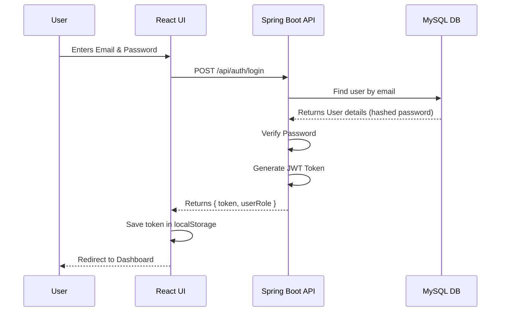
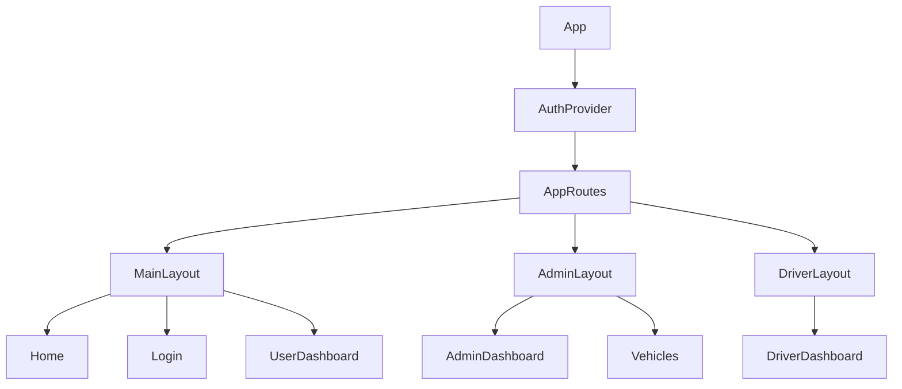

# Fleet Management System - Complete Project Documentation

Welcome to the comprehensive documentation for the **Fleet Management System** (FleetPulse). This document is designed for developers, interviewers, and stakeholders to understand the complete architecture, workflows, and module-level details of the application.

---

## 1. Project Overview

The **Fleet Management System** is a full-stack web application designed to manage vehicles, drivers, bookings, and users efficiently. It provides role-based access for Admins, Drivers, and Users to perform their specific tasks.

- **Frontend**: React.js (Vite), React Router DOM, Tailwind CSS (Custom Styling), Axios
- **Backend**: Java, Spring Boot 3, Spring Security, JWT Authentication, OAuth2 (Google Login)
- **Database**: MySQL, Spring Data JPA (Hibernate)
- **Architecture**: RESTful APIs with Client-Server Architecture

---

## 2. Folder Structure

### Frontend Structure
```text
frontend/
├── src/
│   ├── assets/       # Static files (images, icons)
│   ├── components/   # Reusable UI components (Buttons, Modals, Navbar)
│   ├── context/      # React Context API (AuthContext for state management)
│   ├── hooks/        # Custom React hooks
│   ├── layouts/      # Layout wrappers (MainLayout, AdminLayout, DriverLayout)
│   ├── pages/        # UI Pages grouped by roles
│   │   ├── admin/    # Admin dashboard and management pages
│   │   ├── auth/     # Login, Register, OAuth2 Redirect
│   │   ├── driver/   # Driver specific pages
│   │   ├── public/   # Publicly accessible pages (Home, About)
│   │   └── user/     # User specific pages
│   ├── routes/       # Application routing logic (AppRoutes.jsx)
│   ├── services/     # API integration (axios config, auth services)
│   ├── styles/       # Global CSS/Tailwind configurations
│   ├── utils/        # Helper functions
│   ├── App.jsx       # Root component
│   └── main.jsx      # Entry point
├── index.html        # Main HTML template
├── package.json      # Dependencies and scripts
└── vite.config.js    # Vite configuration
```

### Backend Structure
```text
Fleet-Management-System-main/
├── src/main/java/com/fleetmanagement/backend/
│   ├── config/       # App configurations (Security, CORS, DataInitializer)
│   ├── controller/   # REST Controllers (API Endpoints)
│   ├── customexception/# Custom Exception Handling
│   ├── dao/          # Data Access Objects
│   ├── dto/          # Data Transfer Objects (Request/Response models)
│   ├── entity/       # Database Models (JPA Entities)
│   ├── repository/   # Spring Data JPA Repositories
│   ├── security/     # JWT, UserDetails, Authentication Filters
│   └── service/      # Business Logic Layer
├── src/main/resources/
│   ├── application.properties # Database, Server, and OAuth2 credentials
└── pom.xml           # Maven dependencies
```

---

## 3. Frontend Documentation

The frontend is built for high performance and responsiveness using **Vite + React**. 
- **Routing**: `react-router-dom` handles page navigation without reloading. Nested routing is used with Layouts (e.g., `AdminLayout` wraps all `/admin` routes).
- **State Management**: Context API is used to store the logged-in user's state globally (`AuthContext`).
- **Styling**: Vanilla CSS (`index.css` and `App.css`) with standard responsive practices.
- **API Calls**: Axios interceptors attach JWT tokens to all outgoing requests.

---

## 4. Backend Documentation

The backend is built with **Spring Boot** and follows the standard MVC (Model-View-Controller) pattern, adapted for REST APIs (Controller-Service-Repository).
- **Entities**: Java classes mapped to database tables using `@Entity`. Example: `User.java`, `Vehicle.java`, `Booking.java`.
- **Repositories**: Interfaces extending `JpaRepository` for ready-made CRUD operations.
- **Services**: Contain all core business logic (e.g., calculating booking costs, assigning drivers).
- **Controllers**: Expose REST endpoints (`@RestController`) and map HTTP requests.

---

## 5. Database Documentation

The project uses **MySQL**. Key relationships:
- **User** (1 to Many) **Bookings**
- **Driver** (1 to Many) **Bookings**
- **Vehicle** (1 to Many) **Bookings**

**Key Tables**:
- `users`: Stores Admin, Driver, and Customer data.
- `vehicles`: Stores vehicle details, status, and pricing.
- `bookings`: Maps users to vehicles, tracking dates and statuses.
- `drivers`: Stores driver specific details like license number and availability.

---

## 6. API Documentation

| Method | Endpoint | Purpose | Access Level |
|---|---|---|---|
| POST | `/api/auth/register` | Register a new user | Public |
| POST | `/api/auth/login` | Authenticate and get JWT | Public |
| GET | `/api/admin/users` | Get all registered users | Admin |
| POST | `/api/admin/vehicles` | Add a new vehicle | Admin |
| GET | `/api/vehicles/available` | Get vehicles ready for booking | Public/User |
| POST | `/api/bookings/create` | Create a new booking | User |
| GET | `/api/driver/trips` | Get assigned trips for driver | Driver |

---

## 7. Authentication Flow

**JWT Flow**:
1. User enters credentials on `/login`.
2. Frontend calls `/api/auth/login`.
3. Backend validates against DB.
4. Backend generates a JWT token and returns it.
5. Frontend saves token in `localStorage` and updates `AuthContext`.
6. Subsequent requests send `Authorization: Bearer <token>`.

**OAuth2 (Google) Flow**:
1. User clicks "Login with Google".
2. Redirected to Google's consent screen.
3. Upon success, Google redirects to the backend (`/oauth2/callback`).
4. Backend generates JWT and redirects to frontend `OAuth2RedirectHandler` (`/oauth2/redirect?token=...`).
5. Frontend stores token and navigates to the dashboard.

---

## 8. Complete Workflow

1. **Registration/Login**: User authenticates into the system.
2. **Dashboard Rendering**: Based on role (`ROLE_ADMIN`, `ROLE_USER`, `ROLE_DRIVER`), the user is routed to their specific dashboard.
3. **Vehicle Booking (User)**: User views available vehicles, selects dates, and confirms booking.
4. **Booking Management (Admin)**: Admin views new bookings, assigns available drivers and vehicles.
5. **Trip Execution (Driver)**: Driver views assigned trips, updates trip status (Started, Completed).
6. **Payment/Settlement**: System calculates final fare, user pays, admin settles driver earnings.

---

## 9. Screenshot Documentation (UI Pages)

## Login Page

Purpose:
Secure entry point into the system for all user roles.

Features:
- Email/password login
- Google OAuth2 "Continue with Google"
- Registration link

Screenshot:


Caption:
Login page showing authentication form and Google OAuth2 integration.

Screenshot File Path:
screenshots/login-page.png

---

## Register Page

Purpose:
Allows new customers to create an account in the system.

Features:
- Form validation (passwords match, valid email)
- User detail inputs
- Role selection (defaults to User)

Screenshot:


Caption:
Registration page for new user signups.

Screenshot File Path:
screenshots/register-page.png

---

## Home Page

Purpose:
Landing page to showcase the Fleet Management System features and attract users.

Features:
- Hero banner with "Book Now" call-to-action
- Services overview cards
- Public footer navigation

Screenshot:


Caption:
Public landing page for the fleet management service.

Screenshot File Path:
screenshots/home-page.png

---

## Admin Dashboard Page

Purpose:
Central hub for administrators to monitor the entire fleet, drivers, and overall metrics.

Features:
- Statistical metric cards (Total Vehicles, Active Bookings, Total Drivers)
- Sidebar navigation
- Recent activities summary

Screenshot:


Caption:
Main admin dashboard displaying system-wide analytics and metrics.

Screenshot File Path:
screenshots/admin-dashboard.png

---

## Admin Vehicles Page

Purpose:
Allows admins to add, edit, view, or remove vehicles from the fleet.

Features:
- Data table listing all vehicles (Model, Plate No, Status)
- Add/Edit Vehicle modal
- Delete actions

Screenshot:


Caption:
Vehicle management table showing all fleet inventory and statuses.

Screenshot File Path:
screenshots/admin-vehicles.png

---

## Admin Bookings Page

Purpose:
Manage all customer bookings, approve/reject them, and assign drivers.

Features:
- Booking status filters (Pending, Active, Completed)
- Assign Driver action dropdown
- Trip overview

Screenshot:


Caption:
Admin interface for assigning drivers and vehicles to customer bookings.

Screenshot File Path:
screenshots/admin-bookings.png

---

## User Dashboard Page

Purpose:
Personal hub for customers to view their active and past vehicle bookings.

Features:
- "New Booking" button
- List of recent trips and payment status
- Real-time trip status tracking

Screenshot:


Caption:
Customer dashboard showing personal booking history and options to book new rides.

Screenshot File Path:
screenshots/user-dashboard.png

---

## Driver Dashboard Page

Purpose:
Interface for drivers to see their currently assigned trips and update statuses.

Features:
- Current active trip details (Pickup/Dropoff)
- "Start Trip" and "End Trip" action buttons
- Status indicators

Screenshot:


Caption:
Driver interface displaying assigned trips and action buttons for trip updates.

Screenshot File Path:
screenshots/driver-dashboard.png

---

# Required Screenshots Checklist

| Screen Name | Suggested Filename | Status |
|-------------|-------------------|--------|
| Login Page | login-page.png | Capture Required |
| Register Page | register-page.png | Capture Required |
| Home Page | home-page.png | Capture Required |
| Admin Dashboard Page | admin-dashboard.png | Capture Required |
| Admin Vehicles Page | admin-vehicles.png | Capture Required |
| Admin Bookings Page | admin-bookings.png | Capture Required |
| User Dashboard Page | user-dashboard.png | Capture Required |
| Driver Dashboard Page | driver-dashboard.png | Capture Required |

---

# Screenshot Capture Guide

For the best documentation results, please follow these guidelines when capturing your application screens:

1. **Which page to open**: 
   - Start your local development server (`npm run dev` and Spring Boot). 
   - Navigate to the exact pages corresponding to the screens in the checklist (e.g., `http://localhost:5173/login`, `http://localhost:5173/admin/vehicles`).
2. **What should be visible in screenshot**:
   - Capture the full browser window (excluding browser tabs/URL bar if possible) or the complete web page frame.
   - For dashboards, ensure the sidebar navigation and main content area are clearly visible.
   - For tables (like Vehicles/Bookings), ensure there is dummy data populated so the table doesn't look empty.
3. **Recommended resolution**: 
   - Standard Desktop Resolution: `1920x1080` or `1440x900`. Keep it consistent across all captures.
4. **Recommended browser zoom**: 
   - Keep browser zoom exactly at `100%` to ensure UI elements are not distorted.
5. **Desktop/Mobile screenshots required or not**:
   - Only Desktop screenshots are required for this documentation phase. If the application is fully mobile-responsive, you may optionally create a separate `screenshots/mobile/` directory and capture responsive views, but they are not mandatory for this setup.

**Storage Instructions**: Create a folder named `screenshots` at the root of your project or wherever this documentation resides, and save the images with the exact filenames listed in the Checklist.

---

## 10. File-wise Explanation

### Frontend
- **`AppRoutes.jsx`**: The core routing engine. Maps URLs to specific React components and enforces Layout wrappers based on user roles.
- **`main.jsx`**: The React application entry point. Renders the `<App />` inside the DOM root and provides Context Providers.
- **`AuthContext.jsx`**: React Context that holds the `user` object and `login`/`logout` functions globally.

### Backend
- **`AuthController.java`**: Handles `/login`, `/register`, and token issuance.
- **`SecurityConfig.java`**: Spring Security configuration. Defines which routes are public vs protected, and integrates the JWT filter and OAuth2 success handlers.
- **`User.java`**: JPA Entity mapping to the `users` table. Includes fields like email, password, and role.
- **`BookingService.java`**: Contains business logic. For example, verifying if a vehicle is available on requested dates before saving a booking.

---

## 11. Sequence Diagrams & Flowcharts

### Authentication Sequence (Mermaid)


### Component Hierarchy (Frontend)


---

## 12. Security Features

1. **Stateless Sessions**: JWT tokens ensure the backend does not need to store session data in memory.
2. **Password Hashing**: BCrypt is used to hash passwords before storing them in the database.
3. **Role-Based Access Control (RBAC)**: Spring Security intercepts requests and checks `@PreAuthorize("hasRole('ADMIN')")` or route matchers.
4. **CORS Policy**: Configured to only accept requests from the trusted frontend origin (`http://localhost:5173`).

---

## 13. Setup & Execution Guide

### Prerequisites
- Java 17+
- Node.js 18+
- MySQL Server 8+
- Maven

### Backend Setup
1. Create a database in MySQL: `CREATE DATABASE fleetdb;`
2. Update `application.properties`:
   ```properties
   spring.datasource.url=jdbc:mysql://localhost:3306/fleetdb
   spring.datasource.username=root
   spring.datasource.password=yourpassword
   ```
3. Navigate to `Fleet-Management-System-main/`
4. Run: `mvnw.cmd spring-boot:run`

### Frontend Setup
1. Navigate to `frontend/`
2. Install dependencies: `npm install`
3. Start dev server: `npm run dev`
4. Access app at `http://localhost:5173`

---

## 14. Interview Questions & Resume Points

### Resume Points
- "Developed a full-stack Fleet Management System using React.js and Spring Boot, serving 3 distinct user roles (Admin, Driver, Customer)."
- "Implemented secure authentication utilizing JWT and OAuth2 (Google Login), managed by Spring Security."
- "Engineered a normalized MySQL database schema using Spring Data JPA (Hibernate) to handle complex relationships between users, vehicles, and bookings."
- "Designed a responsive UI using Tailwind CSS and Vite, improving development speed and user experience."

### Interview Questions
1. **How did you handle route protection in React?**
   *Answer: By creating higher-order components (HOCs) or checking the `AuthContext` state inside the routing logic. If a user tries to access `/admin` without the `ROLE_ADMIN`, they are redirected using `<Navigate to="/" />`.*
2. **Explain the flow of your JWT implementation.**
   *Answer: User logs in, backend validates and signs a JWT. Frontend stores it in `localStorage` and attaches it as a `Bearer` token in the Axios interceptor for every subsequent API call. Spring Security's `OncePerRequestFilter` extracts and validates the token.*
3. **How does your database handle vehicle availability?**
   *Answer: By querying the `bookings` table to ensure no active bookings exist for a specific vehicle's ID overlapping with the requested start and end dates.*

---

## 15. Challenges and Solutions

**Challenge**: State loss on page refresh in React.
**Solution**: Utilized `localStorage` to persist the JWT token. On application load (inside `AuthContext`), the token is checked, and if valid, user details are refetched or decoded to restore the global state instantly.

**Challenge**: Handling complex Google OAuth2 redirect flow between backend and frontend.
**Solution**: Implemented an `OAuth2RedirectHandler` page in React. The backend, upon successful Google login, redirects to `http://localhost:5173/oauth2/redirect?token=xxx`. React extracts the token from the URL params, saves it, and navigates the user securely.

---

## 16. Future Enhancements
- **Live Tracking**: Integrate Google Maps API to track driver locations in real-time.
- **Payment Gateway**: Integrate Stripe or Razorpay for online booking payments.
- **Notifications**: Add WebSockets or Firebase for real-time push notifications when a trip starts or ends.

---
*End of Documentation*
